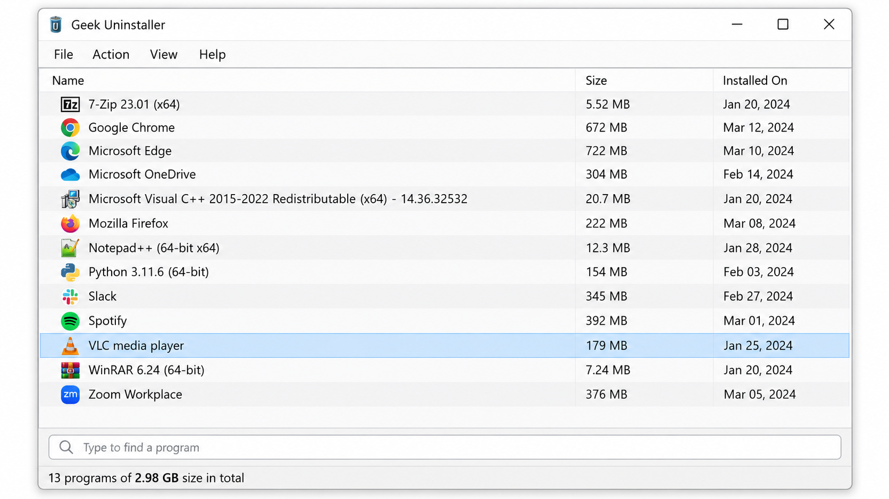
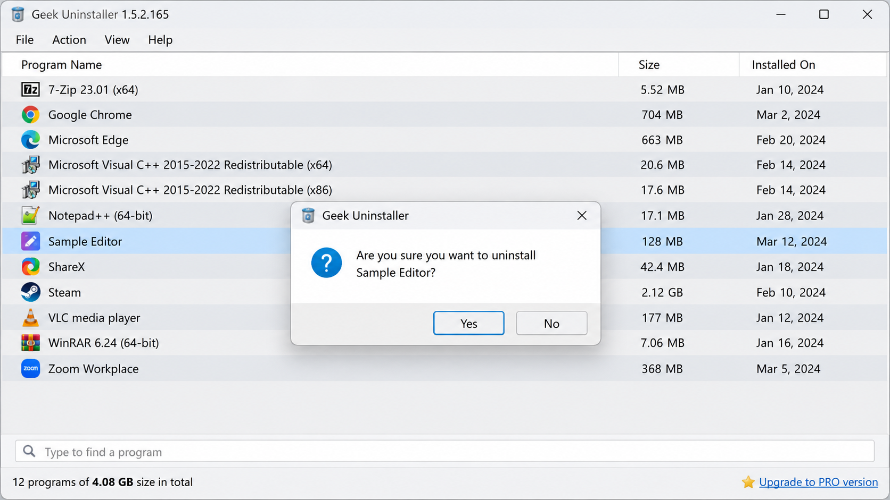
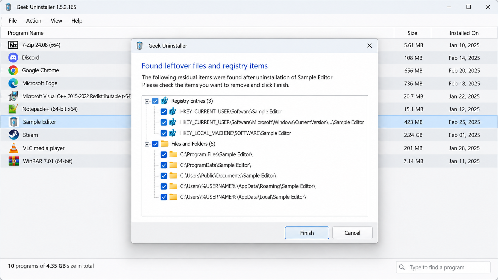

# Geek Uninstaller - Fast Portable Windows Software Removal

Geek Uninstall maintains Geek Uninstaller, a lightweight Windows utility for removing desktop programs, Microsoft Store apps, orphaned entries, and leftover files. Geek Uninstaller combines guided removal, deep scanning, and force removal in a straightforward desktop interface.

[](https://geek-uninstall.github.io/geek-uninstaller/geek-uninstaller)

> [!WARNING]
> Removing applications, registry entries, or shared files can affect Windows and other software. Review every selected item, create a backup when appropriate, and use Geek Uninstaller force removal only when normal removal fails.



## Quick Start

Geek Uninstaller portable operation requires no conventional setup:

1. Obtain the release build.
2. Extract the archive to a writable folder.
3. Start Geek Uninstaller.
4. Approve elevation when Windows requests administrator access.
5. Select a program and run its standard uninstaller.
6. Review the Geek Uninstaller deep scan results before deleting leftovers.

Geek Uninstall recommends trying standard removal first. Geek Uninstaller force removal is intended for damaged entries, missing uninstall commands, and stubborn software that cannot be removed normally.

### Is Geek uninstaller safe to use?

Geek Uninstaller is designed to make destructive actions visible before they are completed. The confirmation workflow, represented by [UninstallConfirmation.cs](src/UninstallConfirmation.cs), separates selection from execution, while [UninstallProgressWindow.cs](src/UninstallProgressWindow.cs) reports ongoing work. Cleanup candidates are represented separately for files, registry keys, registry values, shortcuts, startup entries, and processes.

No uninstaller can guarantee that every detected leftover is safe to delete. Shared folders, shared registry values, active services, and manually selected targets require careful review. Download builds only from a source you trust, compare release information with the Geek Uninstaller official website, and inspect the repository history and [SECURITY.md](SECURITY.md) before running unfamiliar binaries.

Geek Uninstall does not recommend disabling security controls or running unrelated scripts to use Geek Uninstaller. The Geek Uninstaller safe workflow is standard removal, reviewed deep scan results, and force removal only as a final step. These controls support a Geek Uninstaller legit distribution, but users should still verify signatures and release provenance.

## Features

Geek Uninstaller focuses on software removal rather than broad Windows customization.

- **Portable operation:** Geek Uninstaller portable builds can run from an extracted directory without a standard installation.
- **Standard removal:** Geek Uninstaller starts the registered program uninstaller and monitors its completion.
- **Deep scanning:** Geek Uninstaller deep scan checks common file-system and registry locations after removal.
- **Forced removal:** Geek Uninstaller force removal handles broken records and missing uninstall commands.
- **Store support:** Geek Uninstaller Microsoft Store apps support covers installed Store packages.
- **Orphan detection:** Geek Uninstaller detects entries whose files or uninstall commands no longer exist.
- **Multiple installer types:** MSI, Inno Setup, and NSIS uninstall commands receive specialized handling.
- **Additional sources:** The application model includes Steam, Chocolatey, Scoop, browser, service, startup, and script-backed entries.
- **Cleanup review:** Leftover files and registry data remain visible for review before deletion.



### App Removal

Geek Uninstaller discovers applications through multiple factories and scanners. [RegistryFactory.cs](src/RegistryFactory.cs) handles registered desktop software, [StoreAppFactory.cs](src/StoreAppFactory.cs) covers Store packages, and [SteamFactory.cs](src/SteamFactory.cs) covers supported Steam entries. Other sources include [ChocolateyFactory.cs](src/ChocolateyFactory.cs), [ScoopFactory.cs](src/ScoopFactory.cs), and [BrowserEntryFactory.cs](src/BrowserEntryFactory.cs).

Geek Uninstaller leftover removal uses dedicated models for [FileSystemJunk.cs](src/FileSystemJunk.cs), [RegistryKeyJunk.cs](src/RegistryKeyJunk.cs), [RegistryValueJunk.cs](src/RegistryValueJunk.cs), [ShortcutJunk.cs](src/ShortcutJunk.cs), and [StartupJunk.cs](src/StartupJunk.cs). [JunkManager.cs](src/JunkManager.cs) coordinates discovered cleanup candidates.

### What does Geek uninstaller do?

Geek Uninstaller first collects installed application records and identifies the appropriate removal mechanism. It can launch an application's registered uninstaller, wait for its processes, and then inspect likely leftover locations. Specialized generators support MSI, Inno Setup, and NSIS commands when silent or quiet removal information is available.

When an application is broken, Geek Uninstaller force removal can remove its registration and associated remnants without relying on the original uninstaller. Geek Uninstaller deep scan searches for related folders, files, registry keys, shortcuts, startup entries, and orphaned program directories. The user remains responsible for reviewing each result before deletion.

Geek Uninstaller Microsoft Store apps support extends removal beyond classic desktop programs. Geek Uninstaller also recognizes entries associated with package managers and supported software platforms. Geek Uninstall keeps these discovery mechanisms separate so that each source can apply appropriate rules.

### Advanced Features

Geek Uninstaller contains infrastructure for unattended and grouped removal through [AutomatedUninstallManager.cs](src/AutomatedUninstallManager.cs), [BulkUninstallTask.cs](src/BulkUninstallTask.cs), and [BulkUninstallConfiguration.cs](src/BulkUninstallConfiguration.cs). Availability depends on the build and edition.

Geek Uninstaller Pro is the commercial edition associated with Geek Uninstaller batch removal, installation monitoring, and Geek Uninstaller startup manager features. This repository does not claim to unlock paid capabilities or replace a Geek Uninstaller Pro license. Edition-specific behavior should be confirmed before relying on it in managed environments.

## Usage

### Standard Removal

1. Open Geek Uninstaller.
2. Find the application in the main list.
3. Inspect its publisher, location, and uninstall information.
4. Start normal removal.
5. Complete the vendor's uninstaller.
6. Review the Geek Uninstaller leftover removal results.
7. Confirm only the entries that belong to the removed application.

### Force Removal

Use Geek Uninstaller force removal when the registered uninstaller is missing, damaged, or unable to complete. Confirm the selected application carefully because forced cleanup can bypass safeguards supplied by the original installer.

### Microsoft Store Apps

Use the Store application view to locate supported packages. Geek Uninstaller Microsoft Store apps removal may require elevation and can affect applications provisioned for Windows users. Some packages can later be restored through Microsoft Store, while system components may have additional Windows protections.

### Portable Use

Keep the executable and its configuration together when moving Geek Uninstaller portable between systems. Do not place writable settings in protected Windows directories. Run Geek Uninstaller with administrator rights only when an operation requires them.

## At A Glance

geek uninstaller, geek uninstaller portable, geek uninstaller windows 11, geek uninstaller force removal, geek uninstaller Microsoft Store apps, windows-uninstaller, software-removal, force-uninstall, registry-cleanup, leftover-files, portable-app, microsoft-store-apps, windows-11

## System Requirements

| Component | Requirement |
|---|---|
| Operating system | Windows 10 or Windows 11 |
| Architecture | A supported Windows desktop architecture |
| Runtime | The runtime selected by the project configuration |
| Permissions | Administrator access for system-wide removal |
| Development environment | Visual Studio with the required .NET desktop workload |

Geek Uninstaller Windows 10 support covers conventional desktop software and supported Store packages. Geek Uninstaller Windows 11 support includes the same core removal workflow, subject to Windows protections and package rules. Older Windows releases may require an earlier compatible build and are not guaranteed by the current source tree.

## Screenshots



A release screenshot should show the application list clearly, avoid exposing personal paths, and demonstrate the review step before cleanup. Light and dark captures should be checked independently when both themes are available.

### What is the best software uninstaller?

The best software uninstaller is the one that matches the required workflow and makes destructive actions understandable. For everyday cleanup, Geek Uninstaller is a strong fit when portability, quick application discovery, standard removal, and reviewed leftover cleanup matter. Geek Uninstaller portable operation is especially useful for support work where a conventional installation is undesirable.

For managed systems, evaluate unattended execution, logging, package-source coverage, recovery procedures, and edition restrictions. Geek Uninstaller batch removal may be useful for larger application sets, while an individual user may prefer one-at-a-time confirmation. A useful Geek Uninstaller review should test discovery accuracy, normal removal, deep scanning, Store package handling, and behavior when an uninstall command is broken.

### Which is better, Revo Uninstaller or Geek uninstaller?

The better choice depends on the required features rather than the product name alone. Geek Uninstaller emphasizes a compact portable workflow, fast discovery, force removal, Store application support, and cleanup of related remnants. This makes Geek Uninstaller suitable when a lightweight utility and direct removal process are the priority.

Another uninstaller may provide a different monitoring model, interface, or commercial feature set. Compare current editions, licensing, installation monitoring, batch behavior, supported Windows versions, and the amount of control provided over detected leftovers. Choose Geek Uninstaller when its portable design and focused cleanup workflow match the task, and test either product on noncritical software before broad deployment.

## Project Structure

```text
.
├── BulkCrapUninstaller.sln
├── BulkCrapUninstaller.csproj
├── BulkCrapUninstallerTests.csproj
├── Directory.Build.props
├── app.manifest
├── src/
│   ├── Program.cs
│   ├── MainWindow.cs
│   ├── AppUninstaller.cs
│   ├── UninstallManager.cs
│   ├── JunkManager.cs
│   └── StoreAppFactory.cs
└── tests/
    ├── ApplicationEntrySerializerTests.cs
    ├── ApplicationUninstallerEntryTests.cs
    └── UninstallListTests.cs
```

The main solution is [BulkCrapUninstaller.sln](BulkCrapUninstaller.sln). Application startup is defined in [Program.cs](src/Program.cs), the desktop interface is implemented by [MainWindow.cs](src/MainWindow.cs), and removal coordination is handled by [UninstallManager.cs](src/UninstallManager.cs). Settings UI files include [SettingsWindow.cs](src/SettingsWindow.cs) and [SettingsWindow.resx](src/SettingsWindow.resx).

## Build & Develop

Open [BulkCrapUninstaller.sln](BulkCrapUninstaller.sln) in Visual Studio with the required .NET desktop components installed. The repository-level build configuration is stored in [Directory.Build.props](Directory.Build.props), while application metadata and requested Windows privileges are defined in [app.manifest](app.manifest).

Command-line builds can use the solution:

```powershell
dotnet restore BulkCrapUninstaller.sln
dotnet build BulkCrapUninstaller.sln --configuration Release
```

Review warnings before distributing Geek Uninstaller. Changes to removal logic should account for normal uninstall commands, force removal, process waiting, file cleanup, registry cleanup, Store packages, and elevation boundaries.

## Tests

The test project is [BulkCrapUninstallerTests.csproj](BulkCrapUninstallerTests.csproj). Run it from the repository root:

```powershell
dotnet test BulkCrapUninstallerTests.csproj --configuration Release
```

Coverage includes application entry serialization, application metadata, startup arguments, uninstall lists, ratings, and shared test helpers. Changes to Geek Uninstaller deep scan or Geek Uninstaller leftover removal should include focused tests and manual verification against disposable applications.

## Contributing

Geek Uninstall welcomes focused fixes, tests, documentation improvements, and carefully scoped support for additional uninstall mechanisms. Read [CONTRIBUTING.md](CONTRIBUTING.md) before opening a change and follow [CODE_OF_CONDUCT.md](CODE_OF_CONDUCT.md) when participating.

Security-sensitive findings should follow [SECURITY.md](SECURITY.md). Do not publish proof-of-concept code that can delete arbitrary files, bypass confirmation, or elevate commands without validation.

## License

Geek Uninstaller is distributed under the terms in [LICENSE](LICENSE). Review those terms before modifying, redistributing, or using Geek Uninstaller in a commercial environment. Release history is recorded in [CHANGELOG.md](CHANGELOG.md).
